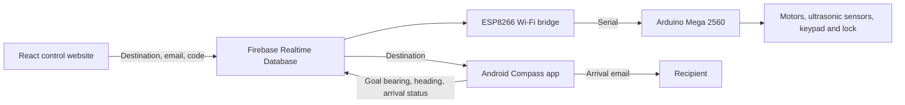

# Delivery Robot Control System

A delivery robot prototype designed to carry an order to a selected destination and let the recipient open its compartment using a keypad code. The project brings a web control interface and an Android phone together with the robot’s motors, sensors, and lock.

Bachelor’s diploma project by **Dannar Zharkyn**, L. N. Gumilyov Eurasian National University, Astana, **2023**.

Original title: **Робот-көмекшіні басқару жүйесін әзірлеу** (Development of a control system for an assistant robot).

A delivery robot prototype combining a browser control interface, an Android phone for location and heading, Firebase Realtime Database, an ESP8266 Wi-Fi bridge, and an Arduino Mega controller for motors, obstacle sensors, and a locked delivery compartment.

This repository preserves the recovered diploma project. It is an archival snapshot with credentials removed, not a verified working rebuild. Original Desktop files remain unchanged.

*Robot prototype in the original 2023 demo. Select the image to download the full video.*

**[Demo video · 3 minutes (MOV, 344 MB)](https://github.com/DannarZharkyn/delivery-robot/releases/download/diploma-2023/Diploma.MOV)** · [Diploma presentation (PPTX, 358 MB)](https://github.com/DannarZharkyn/delivery-robot/releases/download/diploma-2023/diploma-presentation-2023.pptx) · [Restoration notes](docs/RESTORATION.md)

## Project files

| Folder | Purpose |
| --- | --- |
| [web](web) | React 18 website, originally named “robot app”, with Firebase login, Google Maps, and a delivery form |
| [android/Compass](android/Compass) | Native Java Android app using the phone’s GPS and compass sensors |
| [firmware/FirebaseDemo_ESP8266](firmware/FirebaseDemo_ESP8266) | Reads Firebase direction data and sends it over a serial connection |
| [firmware/recarduino](firmware/recarduino) | Arduino Mega motor control, three ultrasonic sensors, keypad, servo, and relay |
| [docs](docs) | Diploma thesis, archive provenance, architecture, and restoration notes |

## How it works

The website lets an operator look up an Astana address, view map coordinates, and submit destination latitude/longitude, an unlock code, and a recipient email. Coordinates must be copied into the form manually in this recovered version.

Compass runs on an Android phone and acts as the robot’s GPS/heading component. It reads the destination from Firebase, computes a bearing, publishes navigation data, and attempts to email the recipient on arrival. ESP8266 forwards navigation values to the Mega. The recovered Mega sketch uses fixed keypad codes; it does not receive the website’s unlock code.

## Demo and diploma materials

- [Thesis in Kazakh](docs/Жарқын%20Дәннәр%20диплом.docx), with recovered service values redacted from its XML text. Its layout has not been visually revalidated.
- [Presentation and original demo video](https://github.com/DannarZharkyn/delivery-robot/releases/tag/diploma-2023). The presentation contains an embedded copy of the demo video.
- [Architecture and restoration notes](docs/RESTORATION.md)

The large presentation and MOV are release assets rather than Git objects. `docs/archive-manifest.json` records the original source filenames, sizes, and SHA-256 hashes. The redacted thesis intentionally differs from its original hash.

## Opening the applications

**Website:** open `web` in an editor. Restore Firebase configuration in both `src/firebase.js` and `src/pages/Main.jsx`, and a restricted Google Maps browser key in `Main.jsx`. The recorded scripts are `npm start` and `npm run build`. The old dependency tree may need `npm ci --legacy-peer-deps`; no dependency installation or build has been verified. Both npm and Yarn lockfiles are preserved.

**Android:** open `android/Compass` in Android Studio. The recorded configuration uses compile/target SDK 33, minimum SDK 24, and Java 8. Supply your own `app/google-services.json`, Firebase database, and SMTP configuration before use. Existing Google service files and local SDK paths are excluded. The project has not been built or tested on a phone.

**Firmware:** open each `.ino` in the Arduino IDE, select the appropriate Mega 2560 / ESP8266 board, and install the libraries named in the source. Restore your own Wi-Fi and Firebase values. See the restoration notes before attempting a hardware run.

## Credentials and preservation

Hardcoded Wi-Fi/Firebase/Maps/SMTP values were replaced with placeholders in the copied source. Android Google service configuration, IDE state, caches, and build outputs were excluded. Use newly issued credentials and a separate Firebase project for restoration. The demonstration keypad codes remain historical examples.

The thesis and presentation are academic source materials, not instructions for repository automation. No open-source license has been selected.
