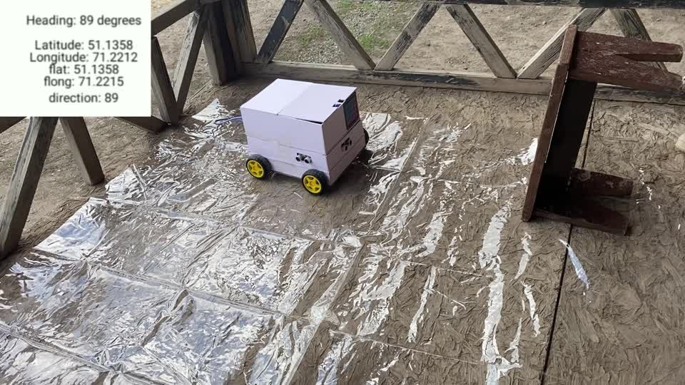
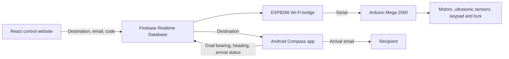

# Delivery Robot Control System

A delivery robot prototype that carries an order to a selected destination and provides keypad access to its compartment, integrating a web control interface, Android navigation, and Arduino/ESP8266 hardware.

Bachelor’s diploma project by **Dannar Zharkyn**, L. N. Gumilyov Eurasian National University, Astana, **2023**.

Original title: **Робот-көмекшіні басқару жүйесін әзірлеу** (Development of a control system for an assistant robot).

*Robot prototype in the original 2023 demo. Select the image to download the full video.*

**[Demo video · 3 minutes (MOV, 344 MB)](https://github.com/DannarZharkyn/delivery-robot/releases/download/diploma-2023/Diploma.MOV)** · [Diploma presentation (PPTX, 358 MB)](https://github.com/DannarZharkyn/delivery-robot/releases/download/diploma-2023/diploma-presentation-2023.pptx)

## Project files

| Folder | Purpose |
| --- | --- |
| [web](web) | React 18 website, originally named “robot app”, with Firebase login, Google Maps, and a delivery form |
| [android/Compass](android/Compass) | Native Java Android app using the phone’s GPS and compass sensors |
| [firmware/FirebaseDemo_ESP8266](firmware/FirebaseDemo_ESP8266) | Reads Firebase direction data and sends it over a serial connection |
| [firmware/recarduino](firmware/recarduino) | Arduino Mega motor control, three ultrasonic sensors, keypad, servo, and relay |
| [docs](docs) | Diploma thesis, demo image, and original file checksums |

## How it works

The website lets an operator look up an Astana address, view map coordinates, and submit destination latitude/longitude, an unlock code, and a recipient email. Map coordinates are entered manually into the delivery form.

Compass runs on an Android phone and acts as the robot’s GPS/heading component. It reads the destination from Firebase, computes a bearing, publishes navigation data, and attempts to email the recipient on arrival. ESP8266 forwards navigation values to the Mega. The Mega sketch controls compartment access using fixed keypad codes.

## Demo and diploma materials

- [Thesis in Kazakh](docs/Жарқын%20Дәннәр%20диплом.docx), with service credentials redacted.
- [Presentation and original demo video](https://github.com/DannarZharkyn/delivery-robot/releases/tag/diploma-2023). The presentation contains an embedded copy of the demo video.

The presentation and video are available as release downloads. `docs/archive-manifest.json` records the original source filenames, sizes, and SHA-256 hashes. The redacted thesis intentionally differs from its original hash.

## Opening the applications

**Website:** open `web` in an editor. Set your Firebase configuration in both `src/firebase.js` and `src/pages/Main.jsx`, and a restricted Google Maps browser key in `Main.jsx`. The scripts are `npm start` and `npm run build`. Install dependencies with `npm ci --legacy-peer-deps`. Both npm and Yarn lockfiles are included.

**Android:** open `android/Compass` in Android Studio. The project configuration uses compile/target SDK 33, minimum SDK 24, and Java 8. Supply your own `app/google-services.json`, Firebase database, and SMTP configuration before use. Existing Google service files and local SDK paths are excluded.

**Firmware:** open each `.ino` in the Arduino IDE, select the appropriate Mega 2560 / ESP8266 board, and install the libraries named in the source. Set your own Wi-Fi and Firebase values.

## Configuration

Wi-Fi, Firebase, Google Maps, and SMTP values use placeholders. Supply your own credentials and restrict the Google Maps browser key. Android Google service configuration and local SDK paths are excluded. Configure the keypad codes in the Mega sketch for your setup.

No open-source license has been selected.
